# Dry Bean Clustering Pipeline: Airflow Lab

An Apache Airflow pipeline that groups dry beans by shape and size with K-Means clustering. The DAG validates the data, cleans and splits it, compares numbers of clusters with the elbow method and the silhouette score, trains and saves the final model, evaluates it on held-out beans, and writes a report. Every run saves its outputs in its own folder.

This project is based on the Airflow Lab (Lab_1) from the course. I first ran the original lab (K-Means on credit card customer data) on Airflow 3.1.5, then rebuilt it with a new dataset, a validation step, fixes for two bugs in the original, a seven-task TaskFlow DAG with parameters and parallel tasks, per-run output folders, pinned dependencies, and tests.

---

## Changes from the original lab

| Area                   | Original lab                                                  | This version                                                                                            |
| ---------------------- | ------------------------------------------------------------- | ------------------------------------------------------------------------------------------------------- |
| Dataset                | Credit card customers, 3 of 17 columns used                   | Dry Bean (UCI), 13,611 beans, all 16 shape and size features                                            |
| Data checks            | None                                                          | `validate_data` task fails the run early and lists every problem found                                  |
| Data cleaning          | Rows with missing values dropped                              | 68 duplicate rows removed, two column name typos in the source file fixed                               |
| Preprocessing          | Min-max scaling                                               | Log transform of the skewed size features, then standard scaling                                        |
| Train/test split       | None (the model is scored on a single row in `test.csv`)      | Stratified 80/20 split, so each bean type keeps its share                                               |
| Choosing k             | Elbow on k = 1 to 49, result only printed                     | Elbow on k = 2 to 15 decides, silhouette score recorded as a second check, plot saved                   |
| Saved model            | The last model fitted (k = 49), not the elbow's k             | The model trained with the chosen k                                                                     |
| Prediction on new data | Raw, unscaled values passed to a model trained on scaled data | Scaling saved inside the model pipeline, so new beans are scaled the same way                           |
| Evaluation             | None                                                          | Silhouette score and adjusted Rand index on 2,709 held-out beans, plus a per-cluster profile            |
| Passing data           | Pickled DataFrames encoded as base64 strings in XCom          | Files saved in a per-run folder, only paths and small summaries passed in XCom                          |
| Outputs                | One `model.sav` file, overwritten by every run                | Nine files per run in `artifacts/<run_id>/`, including a Markdown report                                |
| DAG style              | `PythonOperator`                                              | TaskFlow API (`@task`)                                                                                  |
| DAG tasks              | 4 tasks in a line                                             | 7 tasks, with evaluation and cluster profiling running in parallel                                      |
| Parameters             | None                                                          | `k_min`, `k_max` and `test_size`, set in a form when the DAG is triggered                               |
| Retries                | 0                                                             | 1 retry after 1 minute                                                                                  |
| Dependencies           | Installed unpinned at container start                         | Pinned to the versions in the Airflow 3.1.5 image, in both `docker-compose.yaml` and `requirements.txt` |
| Testing                | None                                                          | 20 pytest tests for the data, model, tasks, and DAG structure                                           |

---

## Dataset

The [Dry Bean dataset](https://archive.ics.uci.edu/dataset/602/dry+bean+dataset) from the UCI Machine Learning Repository (Koklu and Ozkan, 2020) contains 13,611 images of dry beans from seven registered varieties, taken with a high-resolution camera. Sixteen features were extracted from each image: 12 size and dimension measurements and 4 shape factors.

UCI distributes the data as an Excel file. I converted it to `dags/data/dry_bean.csv` with pandas and committed the CSV, so the pipeline needs no internet access.

| Feature group | Features                                                                                                          |
| ------------- | ----------------------------------------------------------------------------------------------------------------- |
| Size          | `Area`, `Perimeter`, `MajorAxisLength`, `MinorAxisLength`, `ConvexArea`, `EquivDiameter`                          |
| Shape         | `AspectRatio`, `Eccentricity`, `Extent`, `Solidity`, `Roundness`, `Compactness`, `ShapeFactor1` to `ShapeFactor4` |
| Label         | `Class`: one of 7 bean types (not used for training, only to check the clusters)                                  |

| Class    | Beans |
| -------- | ----- |
| DERMASON | 3,546 |
| SIRA     | 2,636 |
| SEKER    | 2,027 |
| HOROZ    | 1,928 |
| CALI     | 1,630 |
| BARBUNYA | 1,322 |
| BOMBAY   | 522   |

The file has no missing values and no zero or negative measurements. It has 68 duplicate rows, and two column names have typos (`AspectRation` and `roundness`), which are fixed when the data is loaded.

---

## Project structure

```
MLOPS-Lab5/
├── config/
│   └── airflow.cfg           # Airflow config from the original lab
├── dags/
│   ├── .airflowignore        # Stops Airflow from scanning src/ for DAGs
│   ├── data/
│   │   └── dry_bean.csv      # Dry Bean dataset
│   ├── src/
│   │   ├── __init__.py
│   │   ├── data.py           # Loads, validates, cleans, and splits the data
│   │   ├── model.py          # K-Means pipeline, choosing k, evaluation
│   │   └── tasks.py          # The work each Airflow task does, reading and writing the run folder
│   └── dry_bean_dag.py       # The DAG
├── original_lab/             # Original DAG, code, data, README, and setup script
├── screenshots/              # Screenshots
├── tests/
│   ├── conftest.py           # Shared setup and a small synthetic dataset
│   ├── test_data.py          # Loading, validation, cleaning, and split tests
│   ├── test_model.py         # Pipeline, k selection, and evaluation tests
│   ├── test_tasks.py         # Full pipeline run and task failure tests
│   └── test_dag.py           # DAG structure test (needs Airflow)
├── .gitignore
├── docker-compose.yaml       # Airflow 3.1.5 with pinned libraries and an artifacts volume
├── pytest.ini
├── requirements.txt          # Pinned dependencies for local tests
└── README.md
```

---

## Setup

Requires Docker Desktop with at least 4 GB of memory (8 GB recommended), and Python 3.12 for the local tests. From the repo root:

```bash
mkdir -p logs plugins artifacts
echo -e "AIRFLOW_UID=$(id -u)" > .env
docker compose up airflow-init
```

Wait for `airflow-init-1 exited with code 0`. This only needs to be done once.

For the local tests:

```bash
python3.12 -m venv .venv
source .venv/bin/activate
pip install -r requirements.txt
```

---

## Running the lab

**1. Start Airflow**

```bash
docker compose up
```

Wait about two minutes, then open http://localhost:8080 and log in with `airflow` / `airflow`.

**2. Run the DAG**

On the Dags page, turn on `dry_bean_clustering` and click the trigger button. A form shows the three parameters, which can be changed for each run. A run takes about one minute.

**3. Check the outputs**

Each run writes its files to `artifacts/<run_id>/`, which appears on the host through the volume in `docker-compose.yaml`.

| File                  | Contents                                            |
| --------------------- | --------------------------------------------------- |
| `validation.json`     | Row count, duplicate count, and class counts        |
| `train.csv`           | Training beans                                      |
| `test.csv`            | Held-out beans                                      |
| `k_comparison.csv`    | SSE and silhouette score for each k                 |
| `k_comparison.png`    | Elbow and silhouette plot                           |
| `model.joblib`        | Trained pipeline (preprocessing and K-Means)        |
| `metrics.json`        | Test silhouette and adjusted Rand index             |
| `cluster_profile.csv` | Size, main bean type, and average shape per cluster |
| `report.md`           | Summary of the run                                  |

**4. Run the tests**

```bash
pytest -v
```

**5. Stop Airflow**

```bash
docker compose down
```

---

## The pipeline

| Task               | What it does                                                                                          |
| ------------------ | ----------------------------------------------------------------------------------------------------- |
| `validate_data`    | Creates the run folder and checks columns, row count, missing values, measurement values, and classes |
| `prepare_data`     | Removes duplicates and saves a stratified train/test split                                            |
| `select_k`         | Fits K-Means for each k from `k_min` to `k_max`, saves the comparison, and picks k by the elbow       |
| `train_model`      | Trains the preprocessing and K-Means pipeline with the chosen k and saves it                          |
| `evaluate_model`   | Scores the model on the held-out beans                                                                |
| `profile_clusters` | Describes each cluster on the held-out beans                                                          |
| `write_report`     | Combines everything into `report.md`                                                                  |

`evaluate_model` and `profile_clusters` both only need the trained model, so they run in parallel.

---

## Improvements

**Validation gate.** `validate_data` runs before anything else. If the data has missing columns, too few rows, missing values, zero or negative measurements, or unknown bean types, the task fails with a message listing every problem, and the rest of the pipeline does not run.

**Preprocessing inside the model.** The log transform, scaling, and K-Means are one scikit-learn pipeline, saved as one file. Raw measurements go in and cluster labels come out, so new data is always scaled exactly like the training data.

**Log transform of size features.** BOMBAY beans are far larger than the other types, which skews the six size features. Taking their log before scaling keeps BOMBAY from dominating the distances. The shape features are ratios and are left as they are.

**Two ways of judging k.** The elbow of the SSE curve decides k, as in the original lab. The silhouette score is recorded for every k as a second check, and is used only if no elbow is found.

**External evaluation.** The bean types are never used for training, but they are used afterwards to measure how well the clusters match real varieties, with the adjusted Rand index (1 is a perfect match, 0 is no better than random).

**Per-run folders.** Each run writes to `artifacts/<run_id>/`, so runs never overwrite each other and every result can be traced back to its run.

**File paths in XCom.** Tasks pass only file paths and small summaries. The original passed whole datasets through XCom as base64-encoded pickles, which is slow, hard to read in the UI, and limited in size.

**Pinned versions.** The Airflow image already includes pandas and numpy, so pip installs versions that match them. I pinned those exact versions in `docker-compose.yaml` and `requirements.txt`, so the local tests use the same libraries as the pipeline.

---

## Running the original lab on Airflow 3

The original code is written for Airflow 3, so I ran it with the Airflow 3.1.5 Docker Compose file and made these changes:

- **Compose file.** Set `AIRFLOW__CORE__LOAD_EXAMPLES` to `'false'`, and added `pandas scikit-learn kneed` to `_PIP_ADDITIONAL_REQUIREMENTS`.
- **No `setup.sh`.** The script deletes the `config/` folder, which contains the lab's `airflow.cfg`, so I created the `logs/` and `plugins/` folders and the `.env` file by hand instead.

The original DAG ran successfully. The elbow method chose **8 clusters** and the test row was assigned to **cluster 5**.

**Issues found in the original:**

- **Wrong model saved.** `build_save_model` fits k = 1 to 49 and saves the last model, so the saved model always has 49 clusters. The elbow's k is printed but never used, and the reported cluster comes from the 49-cluster model.
- **Unscaled test data.** The model was trained on min-max scaled data, but `test.csv` is passed in raw. The scaler is not saved, so the prediction cannot be correct. Airflow also logs a scikit-learn warning about feature names for this step.

Both bugs are fixed in this version, and `test_model.py` has a test for each so they stay fixed.

---

## Tests

| File            | Tests | What they check                                                                                                                                                            |
| --------------- | ----- | -------------------------------------------------------------------------------------------------------------------------------------------------------------------------- |
| `test_data.py`  | 8     | The real CSV loads with fixed column names and passes validation, validation lists every problem, duplicates are removed, and the split is stratified and reproducible     |
| `test_model.py` | 7     | Scaling is saved inside the model, the final model uses the chosen k, the elbow finds known groups, the silhouette fallback works, and evaluation and profiles are correct |
| `test_tasks.py` | 4     | The full pipeline writes all nine outputs, run folder names are safe, and bad data or an empty k range fail the task                                                       |
| `test_dag.py`   | 1     | The DAG has 7 tasks, 3 parameters, and the parallel branch. Needs Airflow, so it is skipped in the local venv                                                              |

Most tests use a small synthetic dataset of 400 beans in four clearly separated groups, so the correct answers are known and the tests run in seconds. **19 tests pass** and the DAG test is skipped locally. Inside Docker, Airflow's DAG processor confirms that the DAG loads with no errors.

---

## Results

### Data cleaning

The raw data has **13,611** beans. Removing 68 duplicates leaves **13,543**, split into **10,834** training and **2,709** test beans.

### Choosing k

| k     | SSE        | Silhouette |
| ----- | ---------- | ---------- |
| 2     | 96,712     | 0.405      |
| 3     | 78,407     | 0.361      |
| 4     | 63,443     | 0.329      |
| 5     | 53,014     | 0.348      |
| **6** | **45,394** | **0.324**  |
| 7     | 40,118     | 0.334      |
| 8     | 37,292     | 0.320      |
| 9     | 34,725     | 0.322      |
| 10    | 32,684     | 0.281      |
| 11    | 31,253     | 0.279      |
| 12    | 29,683     | 0.278      |
| 13    | 28,439     | 0.271      |
| 14    | 27,398     | 0.253      |
| 15    | 26,543     | 0.254      |

The elbow is at **k = 6**, close to the 7 real bean types, even though the model never saw the labels. The silhouette score is highest at k = 2, which would split the beans into only two groups. This is why the elbow decides and the silhouette is only a second check: on this data, a high silhouette rewards a split that is clean but not useful.

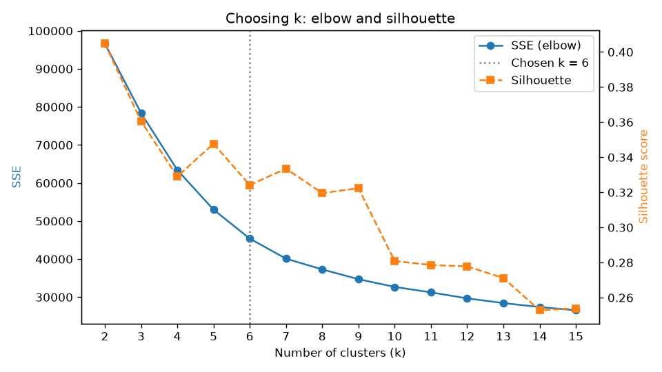

### Clusters on the held-out beans

| Cluster | Beans | Main type | Share of main type |
| ------- | ----- | --------- | ------------------ |
| 0       | 410   | SEKER     | 92.0%              |
| 1       | 572   | CALI      | 54.7%              |
| 2       | 374   | HOROZ     | 92.2%              |
| 3       | 686   | SIRA      | 71.7%              |
| 4       | 104   | BOMBAY    | 100.0%             |
| 5       | 563   | DERMASON  | 97.7%              |

| Metric (2,709 test beans) | Value     |
| ------------------------- | --------- |
| Adjusted Rand index       | **0.675** |
| Silhouette score          | 0.325     |

Four of the six clusters are more than 90% one bean type. BOMBAY is perfectly separated, as expected from its much larger size. SIRA is mostly on its own at 71.7%. The one mixed cluster is CALI at 54.7%. BARBUNYA is not the main type of any cluster, and since BARBUNYA and CALI are both large beans with similar shapes, the CALI cluster is the most likely place for most of them. An adjusted Rand index of 0.675 shows that the clusters match the real varieties well for a model trained without labels.

---

## Screenshots

### Original lab

| Airflow initialized                | Original DAG in the Dags list      |
| ---------------------------------- | ---------------------------------- |
| 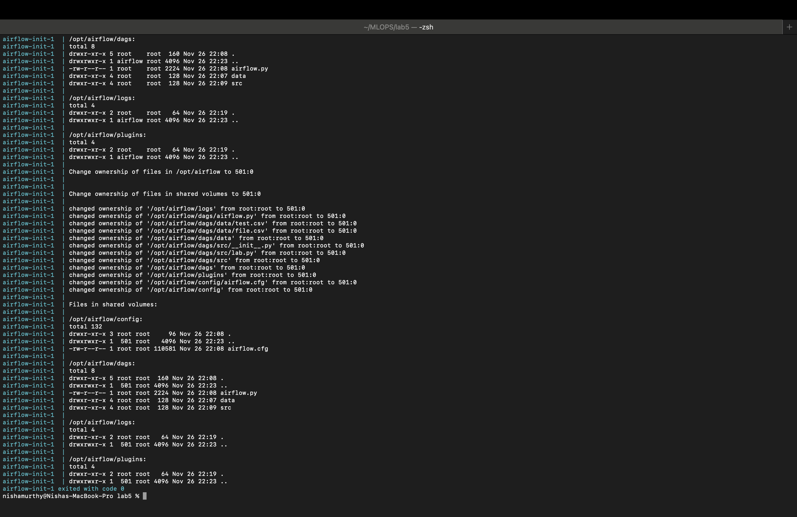 | 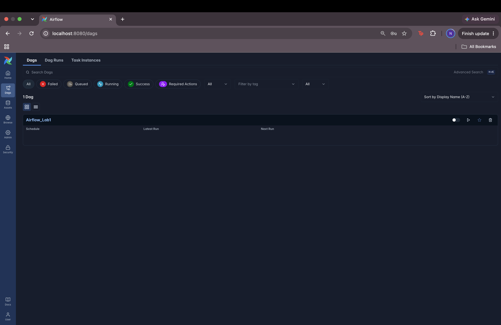 |

| Successful run                            | DAG graph                           |
| ----------------------------------------- | ----------------------------------- |
| 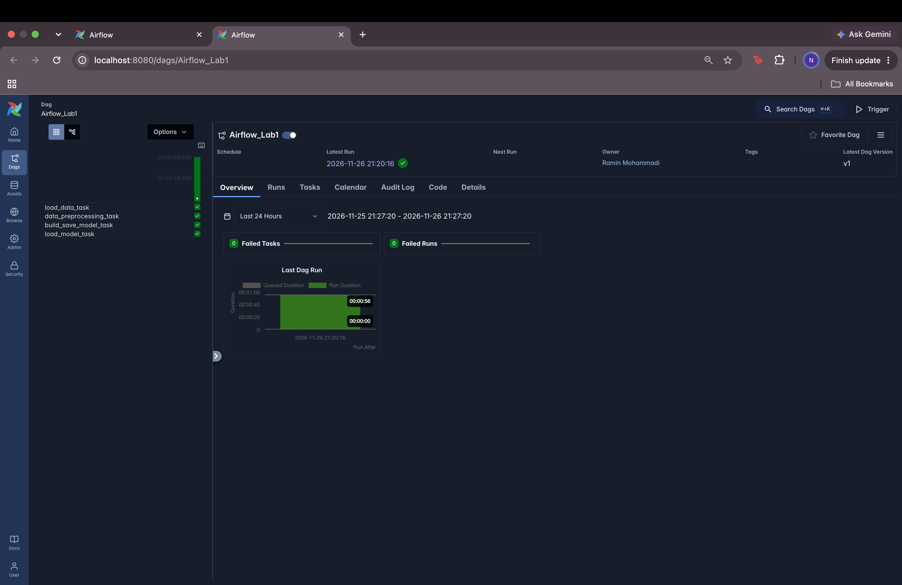 | 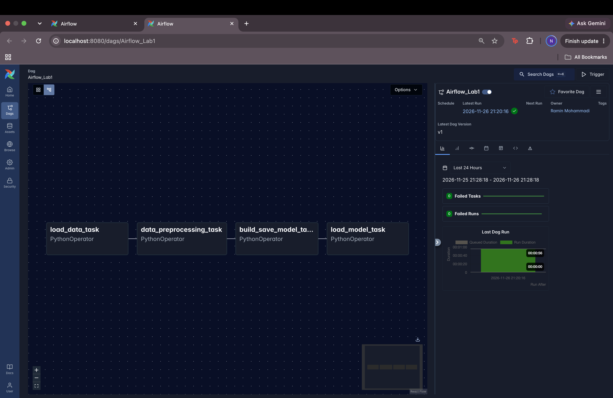 |

**Task log with the elbow result (8 clusters) and the feature names warning**

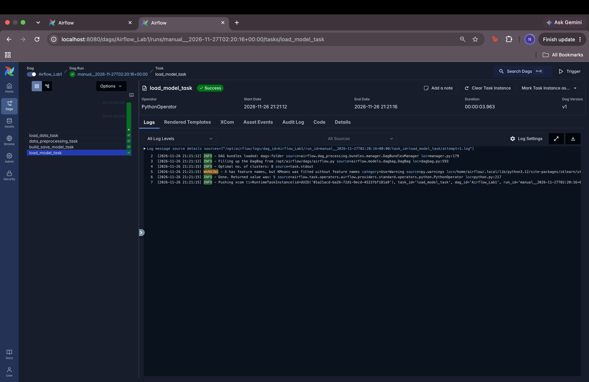

### This version (Dry Bean)

**The new DAG with its tags, after the clean reset**

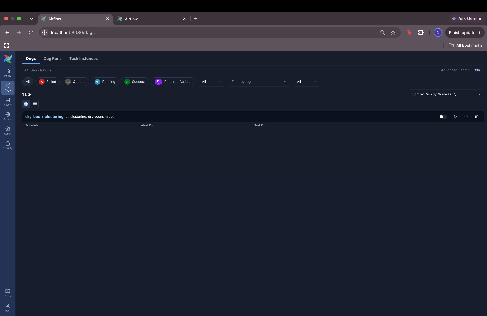

**Trigger form with the three parameters**

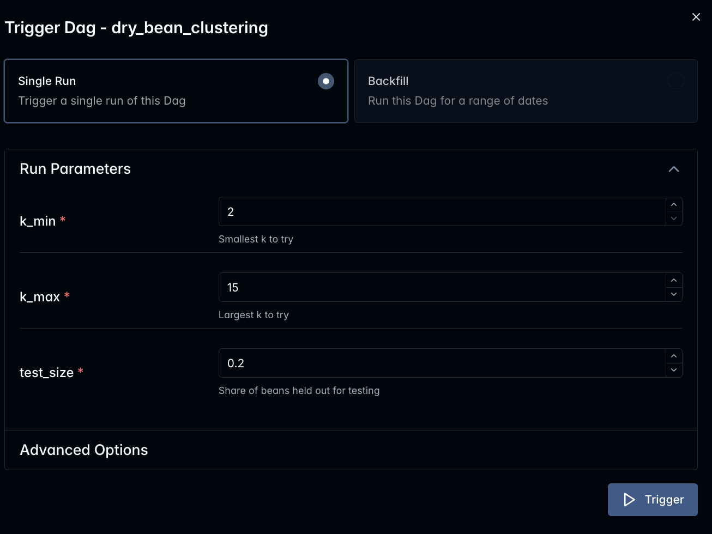

**Successful run: all seven tasks, 0 failed tasks**

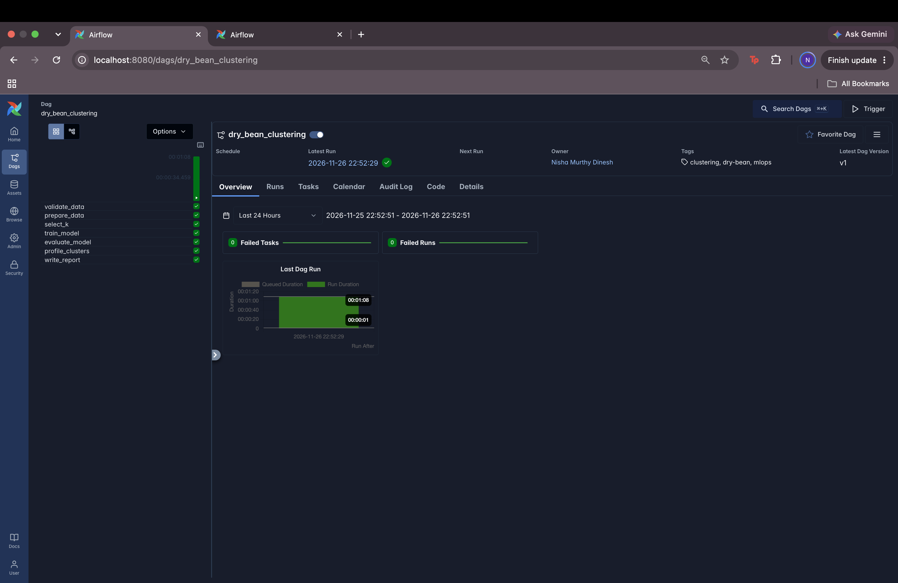

**DAG graph with evaluation and profiling in parallel**

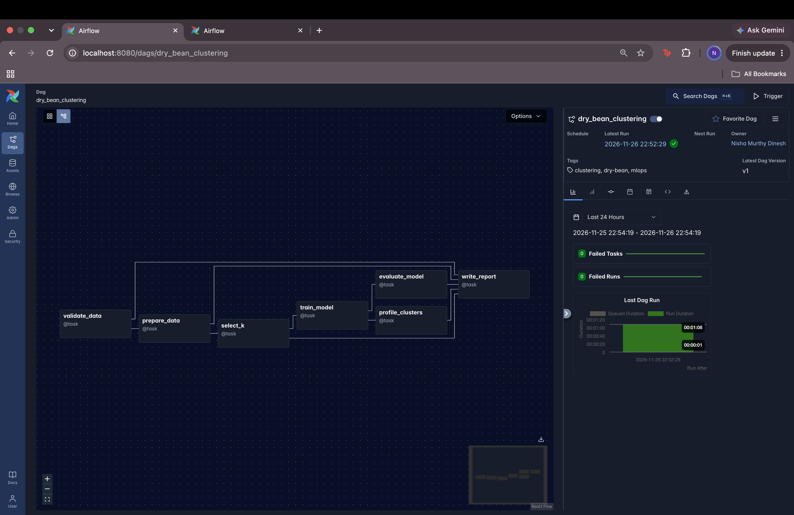

**`select_k` log: k = 6 chosen by the elbow**

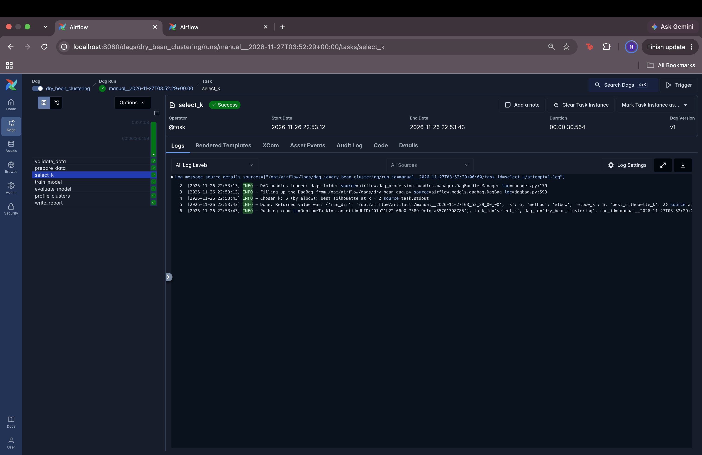

**`write_report` log with the full report**

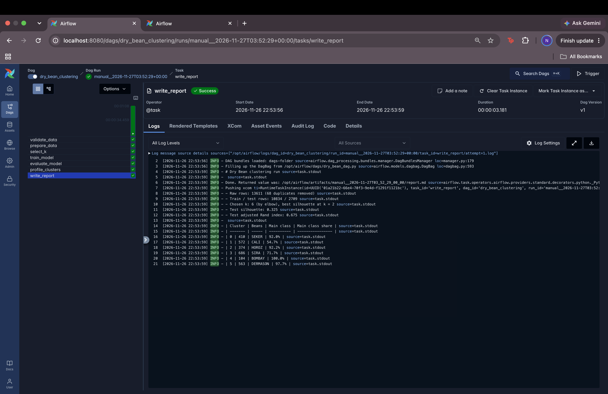

**All tests passing**

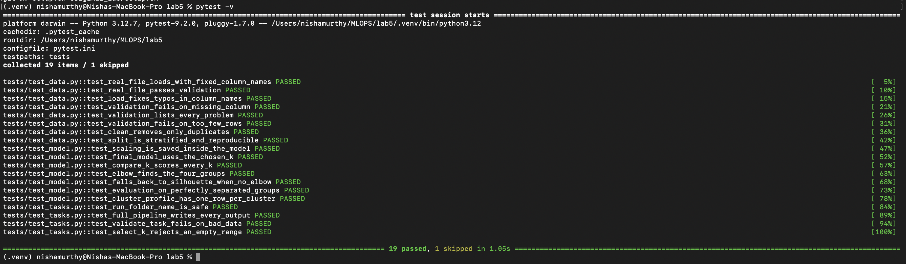
